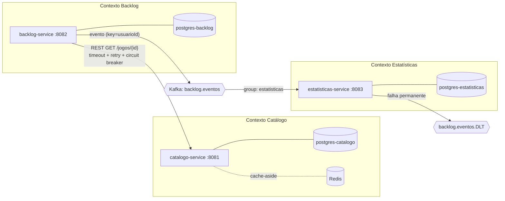
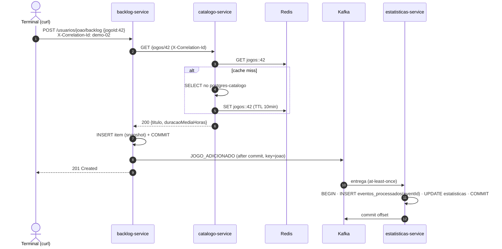

# Arquitetura — LetterGames

## Contextos (bounded contexts)

| Contexto | Dono de | Não sabe de |
|---|---|---|
| Catálogo | o que **é** um jogo (título, plataforma, gênero, duração média) | quem tem o jogo |
| Backlog | a **relação** jogador ↔ jogo e seu status; snapshot de título/duração | estatísticas e conquistas |
| Estatísticas | dados **derivados** (contadores, horas, conquistas) | regras de transição de status |

Regra: **nenhum serviço acessa o banco de outro** (ADR-001).

## Fluxo principal: adicionar jogo e zerar

## Mensageria

| Item | Valor |
|---|---|
| Tópico | `backlog.eventos` (3 partições, chave `usuarioId`) |
| DLT | `backlog.eventos.DLT` |
| Tipos | `JOGO_ADICIONADO`, `STATUS_ALTERADO`, `JOGO_REMOVIDO` (eventos, fatos no passado) |
| Producer | `acks=all`, `enable.idempotence=true`, publicação após o commit da transação |
| Consumer | group `estatisticas`, `enable-auto-commit=false`, `AckMode.RECORD` |
| **Garantia** | **at-least-once**, com consumidor idempotente (`eventos_processados`) → efeito *effectively-once* |
| Retry | bloqueante, `ExponentialBackOff` 1 s ×2, 4 tentativas → DLT |
| Não-retentáveis | erro de desserialização e evento inválido → DLT direto |

## Cache

| Item | Valor |
|---|---|
| Onde | `catalogo-service`, `GET /jogos/{id}` |
| Estratégia | cache-aside (`@Cacheable("jogos")`) |
| TTL | 10 min |
| Invalidação | `@CacheEvict` em `PUT` e `DELETE /jogos/{id}` |
| Fallback | `CacheErrorHandler`: Redis fora → loga `WARN` e lê do banco |

## Resiliência REST (backlog → catálogo)

| Item | Valor |
|---|---|
| Timeout | connect 1 s · read 2 s |
| Retry | 3 tentativas, backoff exponencial a partir de 200 ms, só IO/5xx |
| Circuit breaker | janela de 10 chamadas, 50% de falha, aberto 15 s, 3 chamadas em half-open |
| Fallback | 503 "catálogo indisponível". O item **não** é gravado sem validação |

## Observabilidade

- `X-Correlation-Id` (HTTP) → MDC `correlationId` → header Kafka `correlationId` → MDC no consumidor.
- Padrão de log: `HH:mm:ss.SSS [correlationId] NIVEL Classe - mensagem`, com marcadores visuais (ver CLAUDE.md).

## Contratos

- REST: `shared-contracts/pacts/backlog-service-catalogo-service.json` (gerado pelo consumidor, verificado pelo provedor).
- Evento: `shared-contracts/src/main/java/.../BacklogEvento.java` (campo `versao`).
