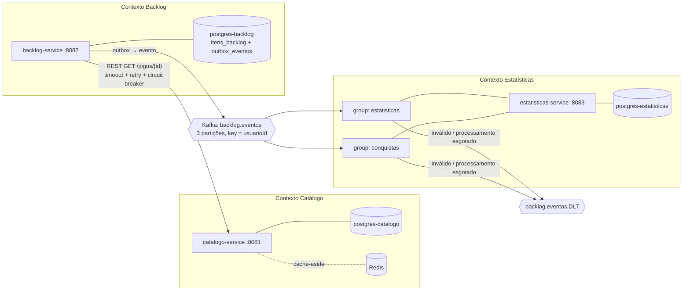
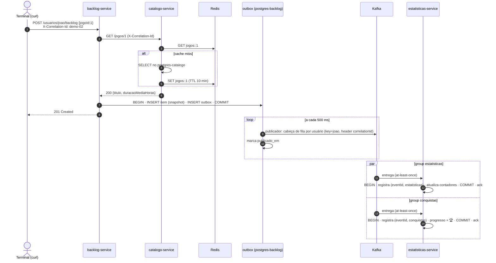

# Arquitetura — LetterGames

## Contextos (bounded contexts)

| Contexto | Dono de | Não sabe de |
|---|---|---|
| Catálogo | o que **é** um jogo (título, plataforma, gênero, duração média) | quem tem o jogo |
| Backlog | a **relação** jogador ↔ jogo, o status e as regras de transição; snapshot de título e duração | estatísticas e conquistas |
| Estatísticas | dados **derivados**: contadores, horas, conquistas (duas projeções, dois groups) | regras de transição de status |

Regra: **nenhum serviço acessa o banco de outro** (ADR-001). O que é compartilhado é só contrato (`shared-contracts`).

## Fluxo principal: adicionar um jogo

## API

| Serviço | Rota | Respostas |
|---|---|---|
| catálogo | `POST /jogos` · `GET /jogos/{id}` · `GET /jogos?plataforma=` · `PUT /jogos/{id}` · `DELETE /jogos/{id}` | 201, 200, 204, 400 `VALIDACAO`, 404 `JOGO_NAO_ENCONTRADO` |
| backlog | `POST /usuarios/{u}/backlog` `{jogoId}` | 201, 400, 409 `JOGO_JA_NO_BACKLOG`, 422 `JOGO_INEXISTENTE`, 502 `CATALOGO_REQUISICAO_INVALIDA`, 503 `CATALOGO_INDISPONIVEL` |
| backlog | `PATCH /usuarios/{u}/backlog/{itemId}` `{status}` · `GET ...?status=` · `DELETE ...` | 200, 204, 404 `ITEM_NAO_ENCONTRADO`, 409 `CONFLITO_CONCORRENTE`, 422 `TRANSICAO_INVALIDA` |
| estatísticas | `GET /usuarios/{u}/estatisticas` · `GET /usuarios/{u}/conquistas` | 200, 400, 503 `BANCO_INDISPONIVEL` |

`usuarioId` e `X-Correlation-Id` seguem `[A-Za-z0-9._-]{1,64}`.

## Mensageria

| Item | Valor |
|---|---|
| Tópico | `backlog.eventos` (3 partições, chave `usuarioId`) |
| DLT | `backlog.eventos.DLT` (3 partições, mesma partição do original) |
| Tipos | `JOGO_ADICIONADO`, `STATUS_ALTERADO`, `JOGO_REMOVIDO` (eventos, fatos no passado), `versao = 1` |
| Produtor | **transactional outbox** (item + evento na mesma transação) + publicador a cada 500 ms; `acks=all`, `enable.idempotence=true`; falha isola a chave; estaciona após 10 falhas não transitórias (queda do broker não conta); erro de banco encerra a rodada |
| Consumidores | groups `estatisticas` e `conquistas`; `enable-auto-commit=false`, `AckMode.RECORD` (offset depois do commit no banco) |
| **Garantia** | **at-least-once**, com consumidor idempotente (`eventos_processados (event_id, consumidor)`) → efeito exatamente uma vez |
| Retry | inválido → DLT direto; transitório → 1 s ×2 até 30 s, por até 10 min; processamento → 4 tentativas (1, 2, 4 s) → DLT |
| Ordem | por usuário: mesma partição, cabeça de fila no outbox (ordem de gravação, coluna `sequencia`) e retry bloqueante no consumidor. Por item, gravação = commit (lock de linha) |

## Cache

| Item | Valor |
|---|---|
| Onde | `catalogo-service`, `GET /jogos/{id}` |
| Estratégia | cache-aside (`@Cacheable("jogos")`); só a leitura popula |
| TTL | 10 min; nulos não são cacheados |
| Invalidação | `@CacheEvict` em `PUT` e `DELETE`, depois do commit, mais um segundo evict 500 ms depois |
| Fallback | `CacheErrorHandler`: Redis fora → loga `WARN` e lê do banco |

## Resiliência REST (backlog → catálogo)

| Item | Valor |
|---|---|
| Timeout | connect 1 s · read 2 s |
| Retry | 3 tentativas, backoff exponencial a partir de 200 ms, só IO/timeout/5xx |
| Circuit breaker | janela 10, mínimo 5, 50% de falha, aberto 15 s, 3 chamadas em half-open |
| 404 / outro 4xx | 422 / 502, sem retry e fora do breaker |
| Fallback | 503 `CATALOGO_INDISPONIVEL`; o item **não** é gravado sem validação |

## Concorrência

`PATCH` e `DELETE` do mesmo item são serializados com `SELECT ... FOR UPDATE`, e `@Version` funciona como rede de segurança (ADR-008).

## Observabilidade

- `X-Correlation-Id` (HTTP) → MDC `correlationId` → coluna `correlation_id` do outbox → header Kafka `correlationId` → MDC no consumidor.
- Padrão de log: `HH:mm:ss.SSS NIVEL [correlationId] Classe - mensagem`, com marcadores: `→ REST`, `← REST`, `✚ ITEM`, `⇢ KAFKA PUB`, `⇠ KAFKA SUB`, `📊 ESTATÍSTICAS`, `🏆 CONQUISTA`, `✔ CACHE HIT`, `✘ CACHE MISS`, `🗑 CACHE EVICT`, `⟳ RETRY`, `⚡ BREAKER`, `↺ DUPLICADO`, `☠ DLT`, `☠ OUTBOX`.

## Contratos

| Contrato | Arquivo | Gera | Verifica |
|---|---|---|---|
| REST `GET /jogos/{id}` | `shared-contracts/pacts/backlog-service-catalogo-service.json` | `CatalogoClientPactTest` (backlog) | `CatalogoPactProviderTest` (catálogo) |
| Mensagem `BacklogEvento` | `shared-contracts/pacts/estatisticas-service-backlog-service.json` | `BacklogEventoPactConsumerTest` (estatísticas) | `BacklogEventoPactProviderTest` (backlog) |
